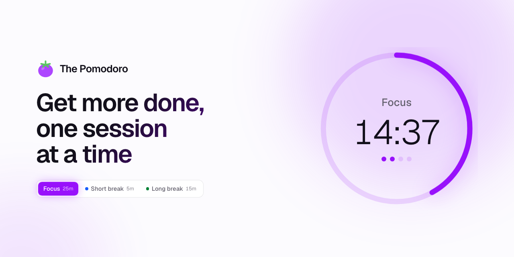
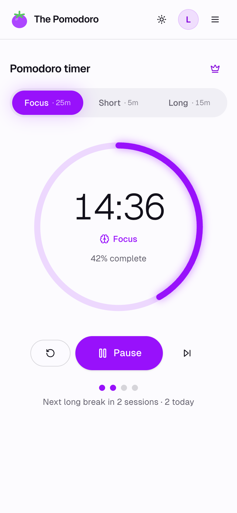
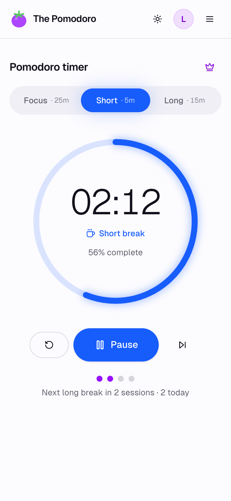
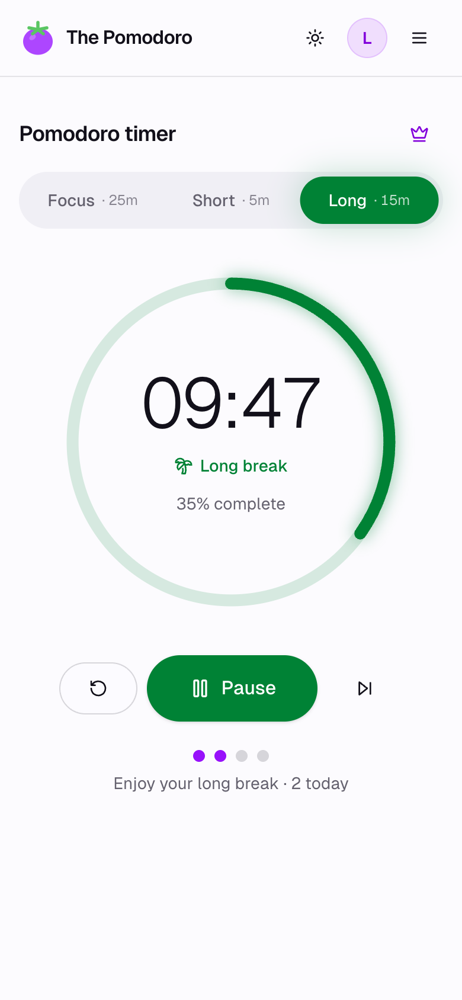
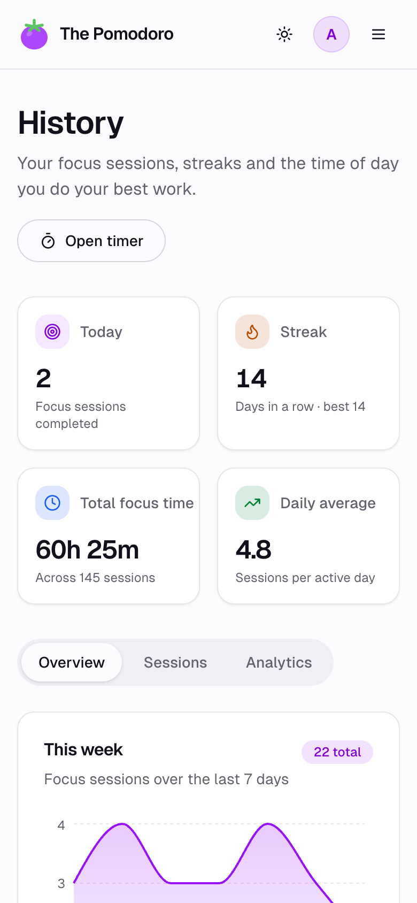
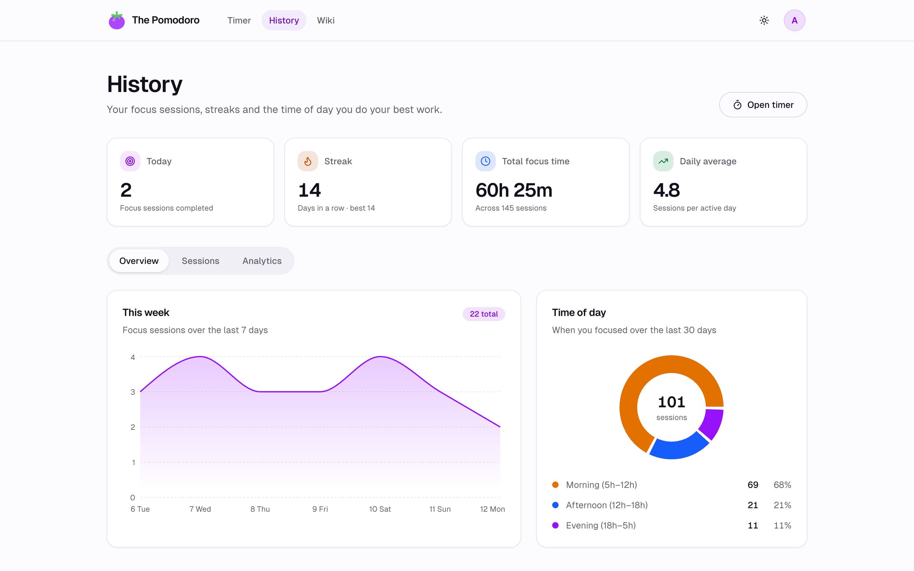
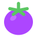

  <picture>
    <source media="(prefers-color-scheme: dark)" srcset="assets/readme-banner-dark.png">
    
  </picture>

  <i>A calm Pomodoro timer for focused work. Focus for twenty-five minutes, rest for five, and watch the sessions add up.</i>

  <a href="https://gabrielsanttana.github.io/thepomodoro/coming-soon/"><b>Open the app</b></a>
  &nbsp;·&nbsp; Back soon, after some infrastructure maintenance &nbsp;·&nbsp;
  <a href="https://gabrielsanttana.github.io/thepomodoro/">gabrielsanttana.github.io/thepomodoro</a>

<table align="center">
  <tr>
    <td align="center"><picture><source media="(prefers-color-scheme: dark)" srcset="assets/screenshots/mobile/focus-dark.png"></picture> FOCUS</td>
    <td align="center"><picture><source media="(prefers-color-scheme: dark)" srcset="assets/screenshots/mobile/short-dark.png"></picture> SHORT BREAK</td>
    <td align="center"><picture><source media="(prefers-color-scheme: dark)" srcset="assets/screenshots/mobile/long-dark.png"></picture> LONG BREAK</td>
    <td align="center"><picture><source media="(prefers-color-scheme: dark)" srcset="assets/screenshots/mobile/history-dark.png"></picture> HISTORY</td>
  </tr>
</table>

---

## The rhythm

The Pomodoro Technique asks for one thing: give a single task your full attention for a short,
fixed stretch, then stop and rest. The Pomodoro keeps the time and the count, so all you have to do
is the work.

|     | Phase           | Length | What to do                                         |
| :-: | --------------- | :----: | -------------------------------------------------- |
| 🟣  | **Focus**       | 25 min | Pick one task. Stay with it until the ring closes. |
| 🔵  | **Short break** | 5 min  | Stand up, stretch, get some water.                 |
| 🟢  | **Long break**  | 15 min | After four pomodoros, rest properly.               |

Each phase has its own colour, so a glance tells you whether to keep going or step away.

## What's in it

- **Three modes, three colours.** Purple for focus, blue for a short break, green for a long one.
- **Hands on the keyboard.** <kbd>Space</kbd> or <kbd>K</kbd> to start and pause, <kbd>R</kbd> to reset, <kbd>S</kbd> to skip.
- **Skip when you need to.** Finished early? Move on, and the cycle keeps its order.
- **The countdown in your tab.** Time left shows in the browser tab and stays accurate in the background.
- **Session dots.** Four dots fill as you go and show how far away the long break is.
- **Light and dark.** Follows your system, or pick a theme yourself.
- **Your own rhythm** _(Premium)_. Set each phase from 1 to 120 minutes, or start from a preset:
  Classic 25/5/15, Extended 45/10/30, Quick Bursts 15/3/10, Study 50/10/20.

## Your history

Every session you finish is saved to your account. The history page _(Premium)_ turns those
sessions into a picture of how you work: your current and best streak, total focus time, your
average per active day, the last seven days, and whether you focus best in the morning, afternoon
or evening.

  <picture>
    <source media="(prefers-color-scheme: dark)" srcset="assets/screenshots/desktop/history-dark.png">
    
  </picture>

## Free and Premium

|                                                | Free |             Premium              |
| ---------------------------------------------- | :--: | :------------------------------: |
| Timer with all three modes, shortcuts and skip |  ✓   |                ✓                 |
| Saved sessions per day                         |  8   |            Unlimited             |
| Custom durations and presets                   |      |                ✓                 |
| History, streaks and analytics                 |      |                ✓                 |
| Price                                          | R$0  | R$1.99 a month or R$19.99 a year |

Payments aren't live yet. Start free and upgrade once checkout opens.

## Questions

**Do I need an account?** 
Yes, a free one. Sign in with Google, or sign up with your email address. Your sessions are saved
to your account, so your history follows you to any device.

**What counts toward the 8 free sessions?** 
Every finished phase: focus sessions and breaks both count. When you reach eight in a day, the
count starts over at midnight.

**Does it work on my phone?** 
Yes. Every screen is designed for phones as well as desktops, so it works in your phone's browser.
An installable version (a PWA) is coming soon: add it to your home screen and it opens like any
other app.

**Why “pomodoro”?** 
It's Italian for tomato. Francesco Cirillo came up with the technique in the late 1980s, timing his
study sessions with a tomato-shaped kitchen timer. Hence the logo.

## Under the hood

A TypeScript monorepo (Turborepo and pnpm), deployed as Docker containers.

- **Web:** Next.js 15 and React 19, Tailwind CSS 4, NextAuth (Google and email), Recharts
- **API:** tRPC over Express 5, with Zod for validation
- **Data:** Prisma and Postgres
- **Jobs:** BullMQ on Redis, sending email through Resend
- **Ops:** Docker, Nginx, Terraform on AWS, GitHub Actions, Infisical for secrets, Sentry

---

   
  A personal project by <a href="mailto:gabriel.gsantana7@gmail.com">Gabriel Santana</a>.

